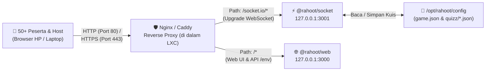

# Panduan Deployment Atomic & Analisa Server Rahoot di Proxmox LXC (Ubuntu 24.04 LTS)

Dokumen ini dirancang secara **komprehensif dan atomic** (setiap langkah berdiri sendiri, memiliki perintah yang spesifik, dan dilengkapi cara verifikasi keberhasilannya). Anda dapat menggunakan panduan ini bersama **Gemini 3.8 Flash** dengan menyebutkan kode langkah (contoh: *"Bantu saya jalankan STEP-01"*).

---

## Bagian 1: Analisa Kebutuhan Server (Proxmox LXC - 50+ Peserta)

### 1.1 Pilihan Arsitektur di Proxmox: Native LXC vs Docker-in-LXC

Karena Anda sudah menggunakan **Proxmox VE** dan akan membuat **Container (LXC) Ubuntu 24.04**, metode terbaik adalah **menjalankan Node.js + Systemd + Reverse Proxy secara langsung (*native*) di dalam LXC**, bukan menjalankan Docker di dalam LXC (*double containerization*).

| Aspek | Native Node.js + Systemd di LXC *(Direkomendasikan)* | Docker di dalam LXC (*Docker-in-LXC*) |
| :--- | :--- | :--- |
| **Konsumsi RAM Idle** | **~280 – 380 MB** | ~650 – 850 MB (overhead `dockerd` & `containerd`) |
| **Kecepatan Boot CT** | **< 2 detik** | 8 – 15 detik |
| **Kompatibilitas Storage Proxmox** | **100% kompatibel** (ZFS, LVM-Thin, Directory) | Rawan isu *overlay2* di atas ZFS & butuh `nesting=1` |
| **Kemudahan Update dari GitHub** | Cukup `git pull && pnpm run build && systemctl restart rahoot` | Harus rebuild image Docker penuh setiap ada perubahan |

---

### 1.2 Spesifikasi Proxmox LXC Container yang Direkomendasikan

Berikut adalah konfigurasi parameter saat membuat CT (*Create CT*) di Proxmox untuk menampung **50 hingga 150+ pemain serentak**:

| Parameter Proxmox CT | Nilai Minimum (50 User) | Nilai Rekomendasi (50 – 150+ User) | Alasan Teknis |
| :--- | :--- | :--- | :--- |
| **CT Mode** | `Unprivileged` (`Yes`) | `Unprivileged` (`Yes`) | Isolasi keamanan terbaik di Proxmox host. |
| **OS Template** | `ubuntu-24.04-standard` | `ubuntu-24.04-standard` | Dukungan LTS panjang, kernel & library modern. |
| **CPU Cores** | `1 Core` | **`2 Cores`** | Saat kuis berjalan, 1 core hanya terpakai <15%. Namun saat menjalankan `pnpm run build` (kompilasi Next.js), 2 core mempercepat build 2x lipat dan mencegah bottleneck. |
| **Memory (RAM)** | `1536 MiB` (1.5 GB) | **`2048 MiB` (2 GB)** | Runtime saat 50 pemain aktif hanya memakan **~380 MB RAM**. Namun proses kompilasi awal (`next build`) membutuhkan *peak memory* sekitar **1.2 – 1.5 GB** selama ~15 detik. |
| **Swap** | `1024 MiB` (1 GB) | **`1024 MiB` (1 GB)** | Jaring pengaman (*safety net*) saat kompilasi Next.js agar tidak pernah terkena *OOM Killer*. |
| **Root Disk** | `8 GB` | **`10 – 12 GB`** | OS Ubuntu (~600 MB) + Node.js 22 (~200 MB) + `node_modules` & `.next` build (~1.2 GB) + Log & Config JSON (<50 MB). Total terpakai hanya **~2.1 GB**. |
| **Network** | Static IPv4 (`vmbr0`) | **Static IPv4 (`vmbr0`)** | Gunakan IP statis (misal `192.168.1.200/24`) agar routing reverse proxy tidak berubah saat reboot. |

---

### 1.3 Arsitektur Jaringan & Reverse Proxy Satu Pintu

Secara default, Rahoot memiliki 2 service:
1. **Web Frontend (`@rahoot/web`)** di port `3000`
2. **WebSocket Server (`@rahoot/socket`)** di port `3001`

Agar peserta tidak terkena masalah blokir port firewall atau CORS di browser HP mereka, kita memasang **Nginx** (atau **Caddy**) di depan aplikasi sehingga **Web dan WebSocket berjalan di 1 alamat/port yang sama**:



> [!IMPORTANT]
> Dengan arsitektur Satu Pintu di atas, baik `WEB_ORIGIN` maupun `SOCKET_URL` di file `.env` cukup diisi dengan **URL yang sama persis** (contoh: `http://192.168.1.200` untuk LAN, atau `https://kuis.domainanda.com` untuk internet publik). Klien Socket.IO otomatis akan menghubungi `/socket.io/` pada alamat tersebut.

---

## Bagian 2: Panduan Deployment Atomic (Step-by-Step)

> [!TIP]
> **Cara Menggunakan Bersama Gemini 3.8 Flash:**
> Anda cukup menyalin atau menyebutkan nomor langkah, misalnya:
> *"Saya sekarang di Proxmox, pandu saya mulai dari STEP-01 secara berurutan."*

---

### FASE 1: Pembuatan LXC Container di Proxmox VE

#### `STEP-01` — Download Template Ubuntu 24.04 di Proxmox Host
* **Lokasi Eksekusi:** Shell **Proxmox Host** (atau lewat GUI: *local (pve) -> CT Templates -> Templates*)
* **Tujuan:** Memastikan template resmi Ubuntu 24.04 LTS tersedia di storage lokal Proxmox.
* **Perintah:**
  ```bash
  pveam update
  pveam available --section system | grep ubuntu-24.04
  pveam download local ubuntu-24.04-standard_24.04-2_amd64.tar.zst
  ```
* **Verifikasi Lulus:**
  ```bash
  pveam list local | grep ubuntu-24.04
  ```
  *(Pastikan muncul file `local:vztmpl/ubuntu-24.04-standard_24.04-2_amd64.tar.zst`)*.

---

#### `STEP-02` — Buat & Jalankan LXC Container Rahoot
* **Lokasi Eksekusi:** Shell **Proxmox Host** (atau lewat tombol **Create CT** di GUI Proxmox)
* **Tujuan:** Membuat container dengan spesifikasi 2 Core CPU, 2048 MB RAM, 1024 MB Swap, 10 GB Disk.
* **Variabel yang Perlu Disesuaikan:**
  * `CTID`: Nomor ID Container (contoh: `200`)
  * `STORAGE`: Nama storage disk VM/CT Anda (umumnya `local-lvm` atau `local-zfs`)
  * `IP_ADDR`: IP statis container beserta CIDR (contoh: `192.168.1.200/24`)
  * `GATEWAY`: IP router/gateway Anda (contoh: `192.168.1.1`)
* **Perintah (Opsi CLI di Proxmox Host):**
  ```bash
  pct create 200 local:vztmpl/ubuntu-24.04-standard_24.04-2_amd64.tar.zst \
    --hostname rahoot \
    --cores 2 \
    --memory 2048 \
    --swap 1024 \
    --storage local-lvm \
    --rootfs local-lvm:10 \
    --net0 name=eth0,bridge=vmbr0,ip=192.168.1.200/24,gw=192.168.1.1 \
    --nameserver 1.1.1.1 \
    --unprivileged 1 \
    --features nesting=1 \
    --onboot 1 \
    --start 1
  ```
* **Masuk ke Dalam Container:**
  ```bash
  pct enter 200
  ```
* **Verifikasi Lulus (di dalam container):**
  ```bash
  hostname && free -m && df -h /
  ```
  *(Pastikan hostname `rahoot`, total Mem `2048`, Swap `1024`, dan disk `/` sekitar `10G`)*.

---

### FASE 2: Persiapan Dasar OS Ubuntu 24.04

*(Mulai dari langkah ini hingga selesai, seluruh perintah dijalankan **di dalam terminal LXC Container `rahoot`** sebagai `root`)*.

#### `STEP-03` — Update Sistem, Timezone, & Paket Esensial
* **Tujuan:** Memperbarui repositori Ubuntu 24.04, mengatur zona waktu, dan memasang dependensi dasar (`git`, `curl`, `build-essential`, `nginx`).
* **Perintah:**
  ```bash
  apt update && apt upgrade -y
  timedatectl set-timezone Asia/Jakarta
  apt install -y curl git ca-certificates gnupg build-essential nginx ufw
  ```
* **Verifikasi Lulus:**
  ```bash
  git --version && nginx -v && date
  ```
  *(Pastikan versi Git, versi Nginx, dan waktu lokal tampil dengan benar)*.

---

#### `STEP-04` — Optimasi Limit File Descriptor untuk WebSocket (50+ User)
* **Tujuan:** Memastikan setiap koneksi WebSocket memiliki batas *open files* yang lega agar tidak terjadi *connection drop* saat 50+ peserta terhubung serentak.
* **Perintah:**
  ```bash
  cat << 'EOF' > /etc/security/limits.d/99-rahoot.conf
  * soft nofile 65535
  * hard nofile 65535
  root soft nofile 65535
  root hard nofile 65535
  EOF
  ```
* **Verifikasi Lulus:**
  ```bash
  cat /etc/security/limits.d/99-rahoot.conf
  ```

---

### FASE 3: Instalasi Runtime Node.js 22 LTS & PNPM

#### `STEP-05` — Install Node.js 22 LTS Resmi (NodeSource)
* **Tujuan:** Memasang Node.js v22 LTS yang direkomendasikan oleh Rahoot.
* **Perintah:**
  ```bash
  curl -fsSL https://deb.nodesource.com/setup_22.x | bash -
  apt install -y nodejs
  ```
* **Verifikasi Lulus:**
  ```bash
  node -v && npm -v
  ```
  *(Output `node -v` harus menunjukkan `v22.x.x`)*.

---

#### `STEP-06` — Aktifkan Corepack & Install PNPM
* **Tujuan:** Mengaktifkan package manager `pnpm` yang digunakan oleh monorepo Rahoot.
* **Perintah:**
  ```bash
  corepack enable
  corepack prepare pnpm@latest --activate
  ```
* **Verifikasi Lulus:**
  ```bash
  pnpm -v
  ```
  *(Output harus menampilkan nomor versi pnpm, misal `10.x` atau `12.x`)*.

---

### FASE 4: Clone & Build Aplikasi Rahoot (`RB-21/rahoot`)

#### `STEP-07` — Clone Repository Fork Anda ke `/opt/rahoot`
* **Tujuan:** Mengunduh kode Rahoot yang sudah dilengkapi **UI Konfigurasi Kuis** dari repositori GitHub Anda (`RB-21/rahoot`).
* **Perintah:**
  ```bash
  git clone https://github.com/RB-21/rahoot.git /opt/rahoot
  cd /opt/rahoot
  ```
* **Verifikasi Lulus:**
  ```bash
  ls -la /opt/rahoot/packages/web/src/components/game/create/QuizzEditor.tsx
  ```
  *(Pastikan file `QuizzEditor.tsx` ditemukan)*.

---

#### `STEP-08` — Konfigurasi `.env` dan Password Manager (`config/game.json`)
* **Tujuan:** Mengatur alamat akses server dan password halaman `/manager`.
* **Catatan Penting:**
  * Jika Anda mengakses server via **IP Lokal (LAN)** (misal `http://192.168.1.200`), isi `APP_URL="http://192.168.1.200"`.
  * Jika Anda mengakses server via **Domain Publik HTTPS** (misal `https://kuis.domainanda.com`), isi `APP_URL="https://kuis.domainanda.com"`.
* **Perintah (Ganti `APP_URL` dan `PASSWORD_MANAGER` sesuai keinginan Anda):**
  ```bash
  APP_URL="http://192.168.1.200"
  PASSWORD_MANAGER="RAHOOT2026"

  cat << EOF > /opt/rahoot/.env
  WEB_ORIGIN=${APP_URL}
  SOCKET_URL=${APP_URL}
  EOF

  cat << EOF > /opt/rahoot/config/game.json
  {
    "managerPassword": "${PASSWORD_MANAGER}",
    "music": true
  }
  EOF
  ```
* **Verifikasi Lulus:**
  ```bash
  cat /opt/rahoot/.env && cat /opt/rahoot/config/game.json
  ```

---

#### `STEP-09` — Install Dependensi & Build Production
* **Tujuan:** Mengunduh seluruh paket monorepo dan meng-compile aplikasi (`@rahoot/socket` dan `@rahoot/web` standalone).
* **Perintah:**
  ```bash
  cd /opt/rahoot
  pnpm install --frozen-lockfile
  pnpm approve-builds --all || true
  pnpm run build
  ```
* **Verifikasi Lulus:**
  ```bash
  ls -lh /opt/rahoot/packages/socket/dist/index.cjs
  ls -lh /opt/rahoot/packages/web/.next/standalone/packages/web/server.js
  ls -d /opt/rahoot/packages/web/.next/standalone/packages/web/.next/static
  ```
  *(Pastikan ketiga path di atas ada dan tidak muncul pesan `No such file or directory`)*.

---

### FASE 5: Pembuatan Service Systemd (Auto-Start & Auto-Restart)

#### `STEP-10` — Buat & Jalankan Service Systemd `rahoot.service`
* **Tujuan:** Menjalankan Rahoot secara otomatis di latar belakang saat container Proxmox dinyalakan, serta otomatis menghidupkan ulang (*auto-restart*) jika terjadi crash.
* **Perintah:**
  ```bash
  cat << 'EOF' > /etc/systemd/system/rahoot.service
  [Unit]
  Description=Rahoot Interactive Quiz Platform (Web + Socket)
  After=network.target

  [Service]
  Type=simple
  User=root
  WorkingDirectory=/opt/rahoot
  Environment=NODE_ENV=production
  Environment=PORT=3000
  Environment=HOSTNAME=127.0.0.1
  Environment=CONFIG_PATH=/opt/rahoot/config
  EnvironmentFile=/opt/rahoot/.env
  ExecStart=/usr/bin/pnpm start
  Restart=always
  RestartSec=5
  LimitNOFILE=65535

  [Install]
  WantedBy=multi-user.target
  EOF

  systemctl daemon-reload
  systemctl enable --now rahoot.service
  ```
* **Verifikasi Lulus:**
  ```bash
  sleep 3
  systemctl status rahoot.service --no-pager
  ss -tulpn | grep -E '3000|3001'
  ```
  *(Pastikan status `active (running)` berwarna hijau, serta port `3000` dan `3001` berstatus `LISTEN`)*.

---

### FASE 6: Konfigurasi Reverse Proxy Satu Pintu (Nginx)

#### `STEP-11` — Konfigurasi Nginx untuk Routing Web & WebSocket di Port 80
* **Tujuan:** Menggabungkan akses Web (port `3000`) dan WebSocket (port `3001`) ke dalam satu port standar (`80`), lengkap dengan dukungan header *WebSocket Upgrade*.
* **Perintah:**
  ```bash
  cat << 'EOF' > /etc/nginx/sites-available/rahoot
  map $http_upgrade $connection_upgrade {
      default upgrade;
      ''      close;
  }

  server {
      listen 80 default_server;
      listen [::]:80 default_server;
      server_name _;

      client_max_body_size 10M;

      # Routing khusus trafik Socket.IO ke port 3001
      location /socket.io/ {
          proxy_pass http://127.0.0.1:3001/socket.io/;
          proxy_http_version 1.1;
          proxy_set_header Upgrade $http_upgrade;
          proxy_set_header Connection $connection_upgrade;
          proxy_set_header Host $host;
          proxy_set_header X-Real-IP $remote_addr;
          proxy_set_header X-Forwarded-For $proxy_add_x_forwarded_for;
          proxy_set_header X-Forwarded-Proto $scheme;

          # Timeout panjang agar koneksi WebSocket pemain tidak putus
          proxy_read_timeout 86400s;
          proxy_send_timeout 86400s;
          proxy_buffering off;
      }

      # Routing seluruh halaman Web & API Next.js ke port 3000
      location / {
          proxy_pass http://127.0.0.1:3000;
          proxy_http_version 1.1;
          proxy_set_header Upgrade $http_upgrade;
          proxy_set_header Connection $connection_upgrade;
          proxy_set_header Host $host;
          proxy_set_header X-Real-IP $remote_addr;
          proxy_set_header X-Forwarded-For $proxy_add_x_forwarded_for;
          proxy_set_header X-Forwarded-Proto $scheme;
      }
  }
  EOF

  rm -f /etc/nginx/sites-enabled/default
  ln -sf /etc/nginx/sites-available/rahoot /etc/nginx/sites-enabled/rahoot
  nginx -t && systemctl restart nginx
  ```
* **Verifikasi Lulus:**
  ```bash
  nginx -t && systemctl is-active nginx
  ```
  *(Pastikan output `syntax is ok`, `test is successful`, dan `active`)*.

---

#### `STEP-12` *(Opsional)* — Aktifkan HTTPS Gratis (Let's Encrypt Certbot) Jika Menggunakan Domain Publik
* **Kondisi:** Jalankan langkah ini **HANYA JIKA** server Anda memiliki domain publik (misal `kuis.domainanda.com`) yang mengarah langsung ke IP publik/port-forwarding port 80 & 443. *(Lewati langkah ini jika Anda menggunakan IP LAN lokal atau menggunakan Cloudflare Tunnel)*.
* **Perintah:**
  ```bash
  apt install -y certbot python3-certbot-nginx
  # Ganti kuis.domainanda.com dengan domain Anda:
  sed -i 's/server_name _;/server_name kuis.domainanda.com;/' /etc/nginx/sites-available/rahoot
  nginx -t && systemctl reload nginx
  certbot --nginx -d kuis.domainanda.com
  ```

---

### FASE 7: Verifikasi End-to-End (Uji Kelayakan Produksi)

#### `STEP-13` — Uji Endpoint Web, Environment, dan Handshake Socket.IO
* **Tujuan:** Memastikan ketiga komponen (Web UI, Endpoint `/env`, dan Socket.IO `/socket.io/`) merespons dengan HTTP 200 melalui Nginx di port 80.
* **Perintah:**
  ```bash
  echo "=== 1. Cek Halaman Utama Web ==="
  curl -s -o /dev/null -w "HTTP Status: %{http_code}\n" http://127.0.0.1/

  echo "=== 2. Cek Endpoint /env ==="
  curl -s http://127.0.0.1/env && echo ""

  echo "=== 3. Cek Handshake Socket.IO via Nginx ==="
  curl -s "http://127.0.0.1/socket.io/?EIO=4&transport=polling" | head -c 120 && echo ""
  ```
* **Verifikasi Lulus:**
  1. Cek 1 menghasilkan `HTTP Status: 200`
  2. Cek 2 menghasilkan JSON `{"webUrl":"...","socketUrl":"..."}`
  3. Cek 3 menghasilkan string paket pembuka Socket.IO yang diawali angka `0{"sid":"...","upgrades":["websocket"],...}`

---

## Bagian 3: Cheat Sheet Operasional & Maintenance

Simpan perintah-perintah singkat ini untuk pemeliharaan sehari-hari di server Proxmox Anda:

| Kebutuhan | Perintah di Terminal Container |
| :--- | :--- |
| **Cek Status Aplikasi** | `systemctl status rahoot` |
| **Lihat Log Real-Time** | `journalctl -u rahoot -f` |
| **Restart Aplikasi** | `systemctl restart rahoot` |
| **Ganti URL Server / Domain** | Edit `/opt/rahoot/.env` lalu jalankan `systemctl restart rahoot` |
| **Ganti Password Manager** | Edit `/opt/rahoot/config/game.json` (tidak perlu restart, langsung aktif) |
| **Backup Semua Kuis** | `tar -czvf ~/backup-kuis-$(date +%F).tar.gz /opt/rahoot/config` |
| **Update Kode dari GitHub Fork Anda** | `cd /opt/rahoot && git pull origin main && pnpm install && pnpm run build && systemctl restart rahoot` |
| **Pantau Penggunaan RAM & CPU** | `htop` atau `free -h` |
